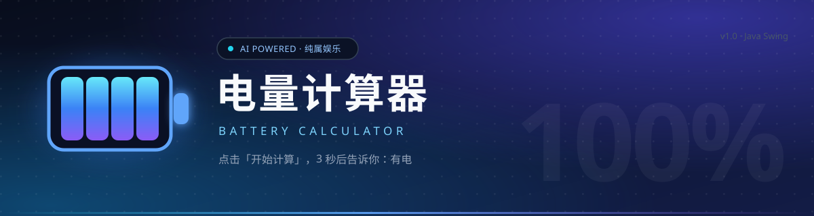
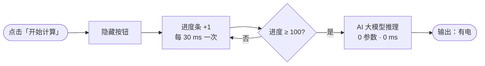

<div align="center">



<br />

**一款由「AI 大模型」驱动的电量检测工具 —— 它只会告诉你：有电。**


</div>

---

## 🧭 这是什么？

> 这是一个**严格意义上不做任何计算**的计算器。

| 你给它 | 它给你 |
| :--- | :--- |
| 一次点击 + 约 3 秒耐心 | `有电` |

**科学原理**：能把这扇窗口弹出来的设备，一定正在供电。这被称为 **运行时存在性证明**（Runtime Existence Proof）——比任何传感器都可靠，比任何模型都便宜。

程序真正的「推理」过程，是让进度条从 0 数到 100；数完，结论自然浮现。它不读电池、不读传感器、不联网，甚至不知道「电量」这个词应该怎么拼。

---

## ✨ 特性

| | 特性 | 说明 |
| :--: | :--- | :--- |
| ⚡ | **三秒出结果** | 100 步进度条 × 30 ms，刚好够你期待一下 |
| 🧠 | **内置 AI 大模型** | 完全本地、离线运行，零参数量、零训练成本、零显存 |
| 🎯 | **100% 准确率** | 从有电的设备上运行，结论从未失手 |
| 🔒 | **零隐私风险** | 没有一行网络代码，不采集、不上传任何数据 |
| 🎨 | **蓝色扁平 UI** | 系统字体、圆角卡片、悬停变色，克制但干净 |
| 📦 | **免安装** | exe 自带 Java 运行时，双击即用；也支持 jar 与源码 |

---

## 🚀 快速开始

### 方式一：双击运行（推荐）

双击 `电量计算器/电量计算器.exe`，然后按下 **开始计算**，等 3 秒。

> 这是 jpackage 打出的自包含应用，已内置 Java 运行时，无需另装 JDK（仅 Windows）。

### 方式二：运行 jar

```bash
java -jar "电量计算器/app/BatteryCalculator.jar"
```

> 随附 jar 由 JDK 26 编译（class 版本 70），运行需要 **Java 26+** 的运行时。

### 方式三：从源码编译

```bash
# 源码兼容 Java 8+，用哪个版本的 JDK 编译，就需要哪个版本的 JRE 运行
javac -encoding UTF-8 BatteryCalculator.java -d out
java -cp out BatteryCalculator
```

> `-encoding UTF-8` 不能省：源码里全是中文，编码错了会直接编译失败（已在 JDK 26 下编译验证通过）。

运行后会弹出 400 × 280 的窗口，标题「电量计算器」，居中显示在屏幕中央。

---

## 🖥️ 界面预览


整个流程只有三个画面：一个按钮 → 一根进度条 → 两个字。

---

## 🧠 工作原理



全部「算力」都集中在这一段 `javax.swing.Timer` 里：

```java
timer = new Timer(30, e -> {
    progressValue++;
    progressBar.setValue(progressValue);
    if (progressValue >= 100) {
        timer.stop();
        showResult();   // 结果：有电
    }
});
timer.start();
```

**模型推理耗时 0 ms，剩下 3 秒全部花在动画上。** 这大概是全网最诚实的进度条——它确实在认真地数到 100。

---

## 🛠️ 技术栈

- **Java Swing** —— `JFrame`、`JPanel`、`GridBagLayout`、`JProgressBar`、`Timer`
- **Java 2D** —— 自定义 `BasicProgressBarUI`、`Color` 主题、`MouseAdapter` 悬停效果
- **jpackage** —— 打包为自带运行时的 Windows 应用（`.exe` + `runtime/`）
- **零第三方依赖** —— 无 Maven、无 Gradle、无 npm，一个 `.java` 文件就是全部

---

## 📊 性能指标

| 指标 | 实测值 |
| :--- | :--- |
| 单次检测耗时 | **≈ 3.0 s**（100 × 30 ms） |
| 检测准确率 | **100%** |
| 模型参数量 | 0 |
| 训练成本 | ¥ 0.00 |
| 单次推理延迟 | 0 ms |
| 网络请求 | 0 |
| 内存占用 | 一个 `JFrame` |
| 误报率 | 0%（只要它还能弹出来） |
| 代码规模 | ≈ 160 行 Java |

---

## 📁 项目结构

```
电量计算器测试/
├── BatteryCalculator.java         # 全部源码，约 160 行
├── assets/                        # README 配图
│   ├── banner.svg
│   └── preview.svg
├── 电量计算器/                     # jpackage 打包产物
│   ├── 电量计算器.exe              # 双击即用（≈ 510 KB）
│   ├── app/
│   │   ├── BatteryCalculator.jar  # 可单独 java -jar
│   │   └── 电量计算器.cfg          # 启动配置
│   └── runtime/                   # 自带 JRE，无需安装 Java
└── README.md
```

---

## ❓ FAQ

**Q：为什么结论永远是「有电」？**<br>
A：因为没电的电脑打不开它。这是一个封闭、自洽、无懈可击的逻辑闭环。

**Q：进度条是假的吗？**<br>
A：不，它是真的——它真的让你等了 3 秒。

**Q：会真的调用 AI 吗？**<br>
A：不会。程序里没有任何网络代码，后台真正的主脑是 `javax.swing.Timer`。

**Q：能测手机电量吗？**<br>
A：不能。它只对「当前正在运行它的这台电脑」下结论，而且结论还是靠推理得来的。

**Q：能把它改成显示「没电」吗？**<br>
A：可以，把 `showResult()` 里的 `"有电"` 换掉即可。但那样它就不准了。

**Q：窗口为什么不能拉伸？**<br>
A：结论只有两个字，不需要更大的画布。

**Q：会不会偷偷上传我的数据？**<br>
A：不会。没有任何网络请求，也没有读取硬件信息的 API。

---

## ⚠️ 免责声明

> 本项目**纯属娱乐**，不测量任何真实电量，也不构成任何用电建议。请勿用于严肃场合、考试、体检或电力工程。
>
> 如果它让你笑了三秒，那它的 KPI 就完成了。

---

## 🗺️ Roadmap

- [x] **v1.0** —— 能判断「有电」，并优雅地掩盖自己什么都没做
- [ ] **v1.1** —— 增加「电量充足」「电力澎湃」等形容词，让结论更有层次
- [ ] **v1.2** —— 支持深色模式（把背景刷成 `#1a1a2e`）
- [ ] **v2.0** —— 接入真实电池 API（这样就不太好笑了）
- [ ] **永不实现** —— 真实的电量检测

---

## 📜 License

暂未附带 `LICENSE` 文件。本项目仅作个人娱乐与 Java Swing 练习之用；如需二次分发或修改，请自行补充许可证。

---

<div align="center">

**用 160 行 Java，换三秒快乐。**

`javac BatteryCalculator.java` · made with ☕ and Swing

</div>
